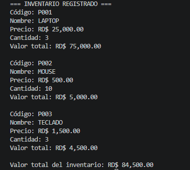
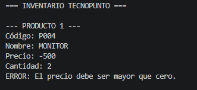
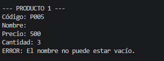
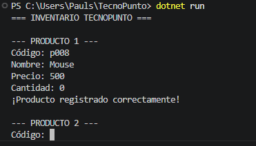

# TecnoPunto - Control de Inventario

## Autor
- Nombre completo: Paul Francisco Santana Alemán
- Matrícula: 2026-1834

## Descripción
Aplicación de consola desarrollada en C# para registrar
productos y calcular el valor total de su inventario.

## Tecnologías
- C#
- .NET 10
- Visual Studio Code

## Funcionalidades
- Registro de tres productos.
- Validación de nombres vacíos.
- Validación de precios mayores que cero.
- Validación de cantidades no negativas.
- Manejo de entradas numéricas incorrectas.
- Cálculo del valor total de cada producto.
- Cálculo del valor total del inventario.

## Datos de entrada
El usuario introduce para cada producto:
- Código del producto.
- Nombre del producto.
- Precio del producto.
- Cantidad disponible.

## Datos que procesa
El programa:
- Valida que el nombre no esté vacío.
- Comprueba que el precio sea mayor que cero.
- Verifica que la cantidad no sea negativa.
- Calcula el valor total de cada producto multiplicando el precio por la cantidad.
- Suma los valores de los tres productos para obtener el total del inventario.

## Datos de salida
El programa muestra:
- Código, nombre, precio y cantidad de cada producto.
- Valor total de cada producto.
- Valor total general del inventario.
- Mensajes de error cuando se introducen datos inválidos.

## Estructura del proyecto
- Producto.cs: clase, propiedades, constructor y métodos.
- Program.cs: registro de productos y manejo de errores.

## Ejecución
Abrir una terminal en la carpeta del proyecto y ejecutar:

dotnet run

## Pruebas realizadas
1. Registro correcto de tres productos.
2. Rechazo de precio negativo.
3. Rechazo de nombre vacío.
4. Rechazo de cantidad negativa.
5. Manejo de entradas no numéricas.

## Ejemplo de ejecución

El programa solicita los datos de tres productos.

### Datos de ejemplo

| Código | Nombre | Precio | Cantidad |
|--------|--------|--------|----------|
| P001 | Laptop | 25000 | 3 |
| P002 | Mouse | 500 | 10 |
| P003 | Teclado | 1500 | 3 |

### Resultados

- Laptop: RD$ 75,000.00
- Mouse: RD$ 5,000.00
- Teclado: RD$ 4,500.00

**Valor total del inventario: RD$ 84,500.00**

## Validaciones implementadas

El sistema rechaza:
- Nombres vacíos.
- Precios iguales o menores que cero.
- Cantidades negativas.
- Entradas no numéricas en precio o cantidad.

Cuando ocurre un error, el programa muestra
un mensaje y permite intentar nuevamente.

## Evidencias de ejecución

### 1. Datos válidos

### 2. Precio negativo

### 3. Nombre vacío

### 4. Cantidad cero

